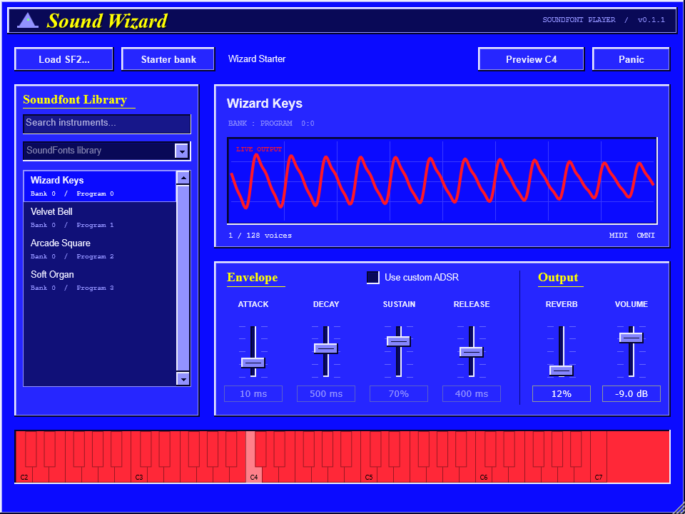
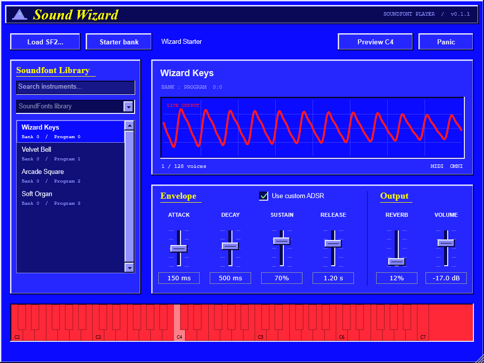

# Sound Wizard

A simple SoundFont player for Windows. Load an `.sf2`, choose an instrument, and play.

Built with JUCE and C++ as a 64-bit VST3 instrument.



## Features

- Load `.sf2` files with a file picker or drag and drop.
- Browse your SoundFonts from a folder in your Windows Music library.
- Search the instruments inside a loaded SoundFont.
- Play chords with velocity, pitch bend, and sustain pedal support.
- Use the SoundFont's original envelope or shape it with custom ADSR.
- Add reverb and adjust the master volume.
- Automate controls and save settings with your DAW project.
- Start playing immediately with four included sounds.

## Install in your DAW

Use a Windows DAW that supports 64-bit VST3 instruments.

1. Download the Windows x64 ZIP from this repository's Releases page and extract it.
2. Close your DAW.
3. Copy the entire `Sound Wizard.vst3` folder into `C:\Program Files\Common Files\VST3`.
4. Reopen your DAW. If Sound Wizard does not appear, rescan VST3 plugins in your DAW's plugin settings or plugin manager.
5. Create an instrument or MIDI track and load **Sound Wizard** from your DAW's instrument browser. Play it with a MIDI keyboard, the plugin's on-screen keyboard, or notes in your DAW's MIDI editor. Enable input monitoring or arm the track if your DAW requires it for live playing.

When updating, replace the entire installed `Sound Wizard.vst3` folder while your DAW is closed.

## Your SoundFonts library

Create a folder called `soundfonts` inside your Windows Music folder and put your `.sf2` files there.

A typical folder looks like this.

```text
Music/
  soundfonts/
    piano.sf2
    synths/
      pads.sf2
```

Open the **SoundFonts library** dropdown to choose a file. It includes subfolders and refreshes whenever you open it. Each person's Music folder is detected through Windows, so the same plugin works with your friends' own library locations.

You can also click **Load SF2...** or drop an `.sf2` file onto the plugin. Choose an instrument from the list on the left. The search box filters instrument names and bank/program numbers.



## Build from source

Install Visual Studio's **Desktop development with C++** workload and a Windows SDK, plus CMake and Git. The build script uses Ninja from Visual Studio's CMake tools.

From the repository folder, run the following in PowerShell.

```powershell
.\build.ps1
```

CMake downloads JUCE **8.0.12** on the first build. An existing JUCE checkout can be supplied with `-DJUCE_DIR=/path/to/JUCE` when configuring CMake. A sibling `JUCE` folder is also detected automatically.

The VST3 is written to `build/release/SoundWizard_artefacts/Release/VST3/Sound Wizard.vst3`. The C++ runtime is linked into the plugin.

The build runs automated checks for audio and MIDI processing, SoundFont loading, state recall, automation, library discovery, and editor controls. To generate the screenshots and an audio audition, run the check tool with an output folder.

```powershell
.\build\release\WizardCheck_artefacts\Release\WizardCheck.exe "$PWD\dist"
```

Live FL Studio verification is performed separately by the user.

## License and credits

Sound Wizard is licensed under **AGPL-3.0-only**. See [LICENSE](LICENSE).

SoundFont playback uses [TinySoundFont](https://github.com/schellingb/TinySoundFont) under the MIT license. Its notice is included in [ThirdParty/LICENSE-TinySoundFont.txt](ThirdParty/LICENSE-TinySoundFont.txt).

The interface and plugin framework use [JUCE](https://github.com/juce-framework/JUCE). See [ThirdParty/LICENSE-JUCE.md](ThirdParty/LICENSE-JUCE.md) for JUCE and dependency license information.

The Wizard Starter waveforms are dedicated to the public domain under CC0. External SoundFonts retain their own licenses.
